# 01 · BAGALIL Video Agent

<div dir="rtl">

**הבעיה:** הכנת סרטון קידום לכל אירוע דרשה עבודה ידנית: התאמה לפורמט 9:16, הלבשת עיצוב המותג וכתיבת טקסט.

**הפתרון:** בוט טלגרם. שולחים לו סרטון גולמי ופרטי אירוע, ומקבלים חזרה תוך דקות סרטון ממותג עם טקסט קידום שנכתב ב-AI. בשימוש שוטף לקידום אירועים.

**החלק שלי:** אפיון, ארכיטקטורה, פרומפטים, בניית שלושת התרחישים ב-Make, טיפול בשגיאות, בדיקות והטמעה.

</div>

## Architecture

```mermaid
flowchart LR
    U[Team member] -->|video + event details| TG[Telegram Bot]
    TG -->|webhook| S1

    subgraph S1[Scenario 1 · Intake & Copy]
        A1[Download file] --> A2[Upload video to Cloudinary]
        A2 --> A3[Gemini API: write copy as JSON]
        A3 --> A4[Parse JSON]
        A4 --> A5[(Airtable: status = pending)]
    end

    subgraph S2[Scenario 2 · Render · every 5 min]
        B1[(View: to_render)] --> B2[HCTI: render RTL text layer PNG]
        B2 --> B3[Upload layer to Cloudinary]
        B3 --> B4[Build transformation URL]
        B4 --> B5[(status = rendered)]
    end

    subgraph S3[Scenario 3 · Deliver · every 5 min]
        C1[(View: to_send)] --> C2[Send video to Telegram]
        C2 --> C3[(status = sent, sent_at)]
    end

    A5 --> B1
    B5 --> C1
    C2 --> U
```



## How the video is rendered

<div dir="rtl">

אין שלב עריכה. Cloudinary מרכיב את הסרטון הסופי מתוך הוראות שכתובות בקישור עצמו:

</div>

```
https://res.cloudinary.com/<cloud>/video/upload/
  c_fill,w_1080,h_1920,g_center/          ← crop to 9:16
  l_<brand_template>,fl_layer_apply,g_north/   ← brand template overlay
  l_<text_layer_id>,fl_layer_apply,g_north/    ← AI-written text layer
  f_mp4,q_auto/<video_public_id>.mp4
```

<div dir="rtl">

שכבת הטקסט נבנית ב-HTML/CSS עם `dir="rtl"` ומרונדרת ל-PNG שקוף דרך HCTI. גודל הכותרת מחושב דינמית לפי אורך הטקסט, כדי שתמיד תישאר בשורה אחת.

</div>

## Data model (Airtable · `events_videos`)

| Field | Purpose |
|-------|---------|
| `status` | `pending` → `text_ready` → `rendered` → `sent` / `error` |
| `line1`–`line4` | AI-generated copy (headline, details, date/venue, CTA) |
| `video_public_id`, `text_png_url`, `final_video_url` | Media references |
| `created_at`, `rendered_at`, `sent_at` | Timestamps per stage |
| `error_note` | Written by error handlers when a stage fails |

## Engineering decisions

<div dir="rtl">

- **שלושה תרחישים במקום אחד:** כל שלב נכשל ומתאושש בנפרד. רשומה שנכשלה ממשיכה מהשלב שבו נעצרה.
- **פלט JSON מ-Gemini:** פורמט קבוע שהאוטומציה יכולה לפרק בלי טעויות.
- **כללי קופי בפרומפט:** כותרת בשורה אחת סביב הנושא שמושך קהל, ושמות אמנים מועתקים מילה במילה מהקלט.
- **מניעת כפילויות:** חיפוש ב-Airtable לפני כל פעולה, ושדה סטטוס שמסמן מה כבר טופל.
- **טיפול בשגיאות:** כל מודול קריטי מקבל ענף שגיאה שכותב `error_note` וסטטוס `error` לרשומה.
- **Retry:** מול שגיאות 429 ו-503 של ה-API בטיר החינמי של Gemini.
- **תיקון טקסט:** אם צריך לשנות משהו, עונים ב-Reply לסרטון שהבוט שלח, והטקסט נכתב מחדש.

</div>

## Stack

Make · Telegram Bot API (webhook) · Gemini API · Cloudinary · HTML/CSS to Image (HCTI) · Airtable
