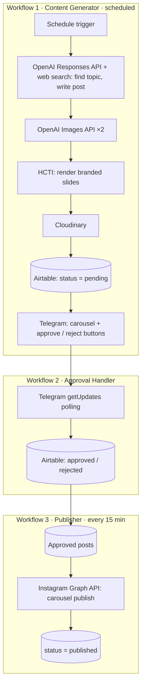

# 02 · Social Content Agent (Human-in-the-loop)

**הבעיה:** הפקת תוכן שוטף לאינסטגרם דורשת זמן: איתור נושאים, כתיבה, תמונות, עיצוב במיתוג ופרסום.

**הפתרון:** סוכן שעושה את כל העבודה, ומשאיר לאדם רק החלטה אחת: לאשר או לדחות כל פוסט בטלגרם.

**החלק שלי:** בניתי את הסוכן קודם ב-Make והעברתי אותו ל-n8n (self-hosted ב-Docker). כולל הגדרת אפליקציית מפתחים ב-Meta, חיבור כל ה-APIs ובניית שלושת ה-workflows.

## Architecture

## Engineering decisions

- **אישור אנושי לפני פרסום:** שום פוסט לא עולה בלי אישור בטלגרם.
- **מניעת חזרתיות:** לפני יצירת פוסט, הסוכן בודק מול הפוסטים האחרונים ב-Airtable ומדלג על נושא שכבר פורסם.
- **Polling ולא webhook לאישור:** n8n רץ על localhost, כך שטלגרם לא יכול לשלוח אליו webhook מבחוץ. לכן ה-workflow שואל את טלגרם בעצמו אם יש עדכונים חדשים.
- **ניהול הרשאות:** טוקן עמוד קבוע של Meta, אימות בכותרות הבקשה (Header Auth) ואימות בסיסי (Basic Auth) ל-APIs שאין להם חיבור מובנה ב-n8n.
- **התאמה למגבלות:** תמונות שנשלחות לטלגרם עוברות דחיסה דרך Cloudinary, כדי לעמוד במגבלת הגודל של sendMediaGroup.
- **מודלים:** התחלתי עם Gemini ועברתי ל-OpenAI, אחרי שהחיפוש המעוגן (grounding) בטיר החינמי של Gemini לא נתן תוצאות שמישות.

## Stack

n8n (Docker, self-hosted) · OpenAI Responses API + web_search · OpenAI Images API · HCTI · Cloudinary · Airtable · Telegram Bot API · Instagram Graph API

הגרסה הקודמת של הסוכן נבנתה ב-Make, בשלושה תרחישים: יצירת תוכן, טיפול באישור ופרסום.

