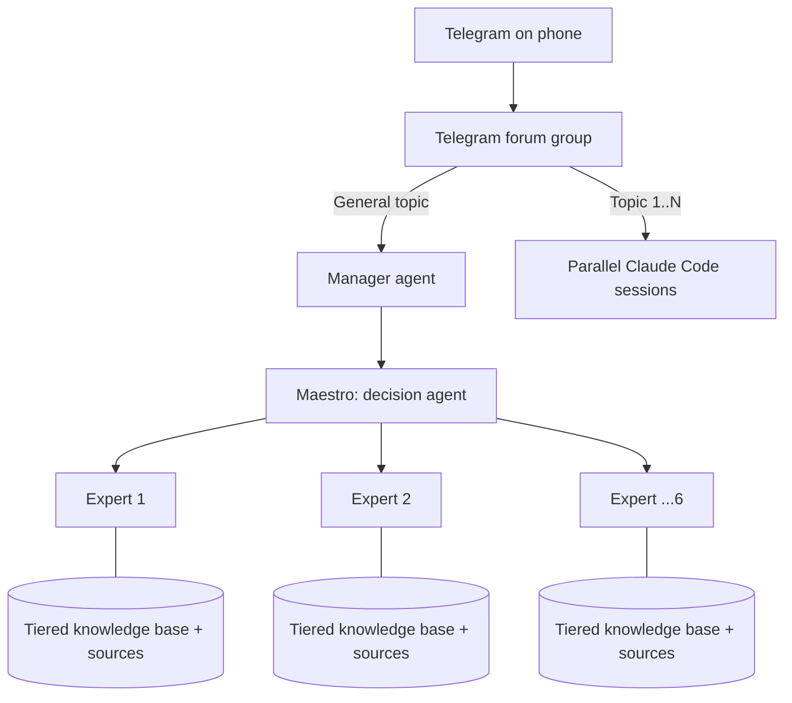

# 03 · Multi-Agent System + Telegram Control Hub

**הבעיה:** רציתי לנהל משימות AI מהטלפון כשאני רחוק מהמחשב, ולקבל החלטות מבוססות ידע אמין ולא תשובות כלליות של מודל.

**הפתרון:** שני רכיבים שעובדים יחד:

1. **Hub בטלגרם:** קבוצת פורום שבה כל Topic הוא סשן נפרד של Claude Code, וכל המשימות רצות במקביל. ה-Topic הכללי משמש כמנהל.
2. **מערכת Multi-agent ("Maestro"):** סוכן מנהל שמקבל החלטות אחרי התייעצות עם שישה סוכני מומחה. המומחים רק ממליצים, וכל אחד מהם מבוסס על בסיס ידע מתועד בתחום שלו.

## Architecture

## Engineering decisions

- **הפרדת תפקידים:** המומחים רק ממליצים, ורק המנהל מחליט. ככה נמנעות התנגשויות בין סוכנים.
- **מניעת הזיות:** כל בסיס ידע מחולק לדרגות אמינות של מקורות, וכל המלצה כוללת ציטוט מקור ושורת רמת ביטחון.
- **מקביליות:** כל משימה רצה ב-Topic ובסשן משלה, עם זיכרון משלה.
- **שימוש חוזר בידע:** שניים מהמומחים, אסטרטגיית שיווק ומכניקת אינסטגרם, הוסבו גם ל-Claude Skills לשימוש ישיר.

## Stack

Claude Code · Telegram Bot API · Claude Skills · curated, source-cited knowledge bases
