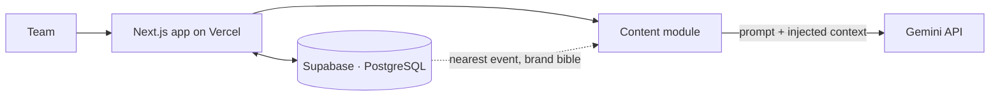

# 04 · Internal Management Dashboard

**הבעיה:** המידע על מותגי חברת ההפקות היה מפוזר בין כמה מקומות, וכתיבת תוכן עם AI הניבה פרטים לא מדויקים על אירועים.

**הפתרון:** מערכת ניהול פנימית אחת למותגי החברה, עם מודול לכתיבת תוכן שמבוסס על Gemini.

## Architecture

## Engineering decisions

- **הזרקת הקשר נגד הזיות:** לפני כל קריאה ל-Gemini, המערכת מוסיפה לפרומפט את התאריך הנוכחי, את האירוע הקרוב ואת מסמך המותג (Brand Bible). כך המודל כותב על אירוע אמיתי ולא ממציא פרטים.
- **הפרדה בין קוד לנתונים:** הקוד יושב ב-GitHub ונפרס אוטומטית ל-Vercel, והנתונים נשמרים ב-Supabase.

## Stack

Next.js · Supabase (PostgreSQL) · Vercel · GitHub · Gemini API
